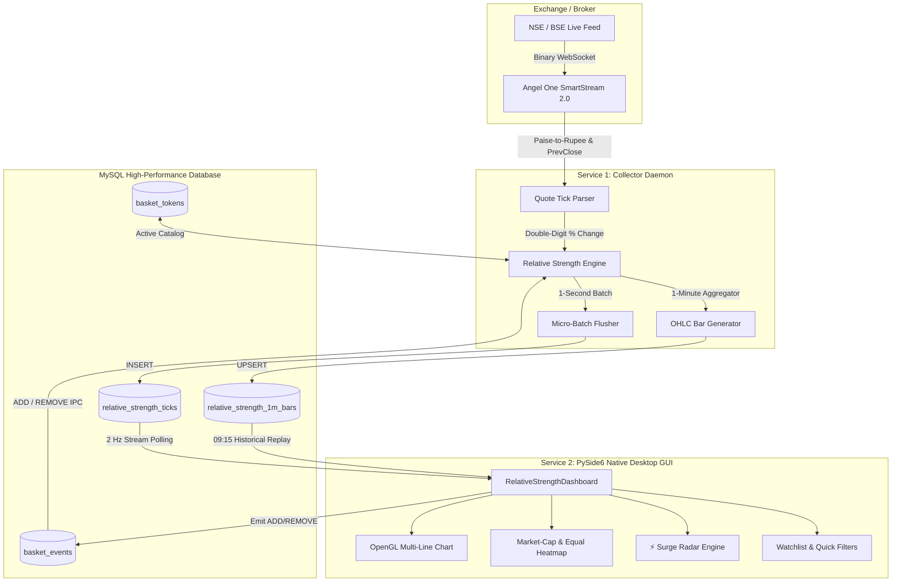

# Live Relative Strength and Heatmap Dashboard 📈🔥

A high-performance, institutional-grade intraday trading platform built with **Python 3.11**, **PySide6 (Qt)**, **PyQtGraph (OpenGL)**, **Angel One SmartAPI SmartStream 2.0 (WebSocket)**, and **MySQL**.

The system computes and visualizes real-time **Relative Strength (% change from previous close)** across all **Nifty 50** constituents and custom user instruments, featuring multi-timeframe line compression, interactive market-cap weighted treemaps, zero-restart dynamic stock subscriptions, and a real-time **⚡ Surge Radar** for sudden momentum detection.

---

## 📸 Key Features & Capabilities

- ⚡ **Multi-Line Relative Strength Visualizer**: OpenGL hardware-accelerated real-time chart tracking dozens of simultaneous stocks plotted against a prominent 0.00% baseline.
- 🕒 **Multi-Timeframe Compression**: Instantly switch between **Live (Raw Ticks)**, **1m**, **2m**, **3m**, **4m**, **5m**, **10m**, **15m**, **30m**, **1h**, **2h**, **3h**, and **4h** with zero reload lag.
- ⚡ **Surge Radar (Momentum Outlier Detection)**: Automatically computes rolling momentum velocity ($$\Delta \% / \Delta t$$) over configurable windows (1–15 minutes). Surging/dumping stocks auto-thicken to 3.5px, jump to front ($$z=90$$), and display clickable alert chips.
- 🔥 **Synchronized Dual-View Heatmap**:
  - **Market-Cap Weighted Treemap**: Mega-caps (Reliance, TCS, HDFC Bank) span larger visual tiles.
  - **Equal-Weighted Grid**: Clean uniform grid showing all basket constituents.
  - One-click cross-linking: Clicking any heatmap tile focuses and highlights its line in the chart tab.
- 🔄 **Zero-Restart Dynamic Token Hot-Reload**: Add or remove any stock on NSE/BSE on the fly (via GUI Dialog, Quick-Add Bar, or CLI) without interrupting running WebSocket streams or chart history.
- 🎯 **Smart Cursor HUD**: Tooltip vertically sorts and displays only the closest 4 stock lines nearest to the mouse cursor, eliminating tooltip clutter.
- 📋 **Watchlist with Real-Time Auto-Sorting**: Sort watchlist by **A → Z**, **Z → A**, **% Change (High → Low)**, **% Change (Low → High)**, or **Default View** with smooth layout preservation.
- 🔘 **One-Click Quick Presets**:
  - `Show All` / `Hide All`
  - `Top 5 Bullish`
  - `Top 5 Bearish`
  - `Top 5 Bulls & Bears Together` (instant dual-extreme divergence)
  - `⚡ Active Spikers` (isolates only surging/dumping stocks)

---

## 🏛️ System Architecture

The project employs a robust **Decoupled Two-Tier Architecture** communicating through MySQL tables and IPC event queues:



---

## ⏰ Market Timing & Session Lifecycle Logic

The platform is designed specifically for Indian Equity Market sessions (**09:15:00 to 15:30:00 IST**):

```
+-----------------------------------+-------------------------------------+----------------------------------+
|      PRE-MARKET (Before 09:15)    |    MARKET HOURS (09:15 - 15:30)     |     POST-MARKET (After 15:30)    |
+-----------------------------------+-------------------------------------+----------------------------------+
| - Authenticates session via TOTP  | - Ingests real-time quote ticks     | - Market closes; ticks settle    |
| - Connects SmartStream WebSocket  | - Calculates relative % change:     | - Historical data preserved      |
| - Subscribes 50+ basket tokens    |   ((LTP - PrevClose)/PrevClose)*100 | - Trader can review, zoom, pan   |
| - Pre-market ticks populate close | - 1s micro-batch flush to MySQL     |   and analyze whole-day moves    |
| - GUI displays ready state        | - 1m OHLC relative bars generated   | - Dynamic tokens remain saved    |
+-----------------------------------+-------------------------------------+----------------------------------+
```

### 1. Pre-Market & Before 09:15 IST
- When `run_collector.py` starts, it validates database tables and logs in to Angel One using your credentials and RFC 6238 TOTP.
- It immediately establishes the SmartStream 2.0 WebSocket connection and sends the subscription packet for all active basket tokens.
- Between 09:00 and 09:08 (Pre-market discovery), exchange ticks update the previous close and opening quotes.
- When `run_dashboard.py` starts before 09:15, it loads the catalog and renders the 0.00% baseline, ready to ingest live ticks the instant the bell rings.

### 2. During Active Market Hours (09:15 to 15:30 IST)
- Angel One pushes high-frequency ticks for all subscribed scrips.
- The collector calculates the signed percentage change:
  $$\text{pct\_change} = \frac{\text{LTP} - \text{PrevClose}}{\text{PrevClose}} \times 100$$
- Micro-batches are inserted into `relative_strength_ticks` every 1.0 second.
- Every completed 60 seconds, a 1-minute OHLC relative performance bar is saved to `relative_strength_1m_bars`.
- The GUI polls recent ticks at 2 Hz (every 500ms), streaming data points to the OpenGL curves, updating heatmap colors, and feeding the **⚡ Surge Radar**.

### 3. Post-Market & Evening Inspection (After 15:30 IST)
- Trading terminates at 15:30 IST. The exchange stops pushing ticks, but the active WebSocket session maintains heartbeat ping/pong.
- If you start the dashboard in the evening, `_bootstrap_data()` queries `fetch_today_1m_bars()` and **instantly replays the entire intraday trading session from 09:15 onwards**.
- Traders can inspect high/low performance, switch between 1m–4h timeframes, test the Surge Radar thresholds, and organize baskets for the next trading day.

---

## 🚀 Installation & Setup

### Prerequisites
- **Python**: Version `3.10` or `3.11` (64-bit recommended).
- **MySQL Server**: Version `8.0` or higher running locally or remotely (default port `3306`).
- **Angel One Trading Account**: With SmartAPI enabled ([smartapi.angelbroking.com](https://smartapi.angelbroking.com)).

### 1. Clone the Repository
```bash
git clone https://github.com/Vatsalbhavsar7/Live-Relative-Strength-and-Heatmap-Dashboard.git
cd Live-Relative-Strength-and-Heatmap-Dashboard
```

### 2. Create and Activate Virtual Environment
```bash
# Windows (PowerShell)
python -m venv venv
.\venv\Scripts\Activate.ps1

# Linux / macOS
python3 -m venv venv
source venv/bin/activate
```

### 3. Install Dependencies
```bash
pip install -r requirements.txt
```

### 4. Configure Credentials
Copy `credentials.example.json` to `credentials.json`:
```bash
cp credentials.example.json credentials.json
```

Edit `credentials.json` with your real keys:
```json
{
  "api_key": "YOUR_ANGEL_ONE_API_KEY",
  "client_code": "YOUR_ANGEL_ONE_CLIENT_CODE",
  "password": "YOUR_TRADING_PIN_OR_PASSWORD",
  "totp_secret": "YOUR_AUTHENTICATOR_TOTP_KEY",
  "mysql": {
    "host": "localhost",
    "port": 3306,
    "user": "root",
    "password": "YOUR_MYSQL_PASSWORD",
    "database": "algo_relative_strength"
  }
}
```

> [!NOTE]
> Environment variables (`ANGELONE_API_KEY`, `ANGELONE_CLIENT_CODE`, `ANGELONE_PASSWORD`, `ANGELONE_TOTP_SECRET`, `DB_PASSWORD`) are also supported and take precedence over `credentials.json`.
>
> **Security Reminder**: `credentials.json` is git-ignored and will never be committed to GitHub.

---

## 🏃 Running the Application

The system runs as two cooperating services:

### Step 1: Start Ingestion Daemon (Service 1)
Open a terminal and start the background collector:
```bash
python run_collector.py
```
*Output:*
```text
================================================================================
  ANGEL ONE - RELATIVE STRENGTH INGESTION DAEMON (SERVICE 1)
================================================================================
[INFO] Loaded 50 active official Nifty 50 tokens from MySQL.
[INFO] Authenticating collector daemon for Client [YOUR_CODE]...
[INFO] Collector authenticated successfully.
[INFO] Connecting SmartStream 2.0 WebSocket...
[INFO] SmartStream WebSocket connected successfully.
[INFO] Subscribed 50 tokens to SmartStream WebSocket.
  [+] Tracking 50 tokens live.
  [+] Micro-batch flush rate: every 1.0s.
  [+] 1-minute OHLC bar aggregator: active.
================================================================================
```

### Step 2: Launch Native Desktop GUI (Service 2)
In a second terminal, launch the desktop interface:
```bash
python run_dashboard.py
```
*The full OpenGL dashboard will open, hydrating today's bars and streaming live tick updates.*

---

## 🛠️ Dynamic Token Management (Zero-Restart)

Add or remove any stock from the live basket without stopping or restarting either service:

### Option A: Via GUI Manage Basket Dialog
1. Click **Manage Basket** in the top-right header.
2. Type any Symbol (e.g., `IDEA`, `BSE`, `TATAPOWER`) or numeric Token ID.
3. Click **Lookup** -> **+ Add to Basket**.
4. The collector daemon and GUI will hot-subscribe within 2 seconds.

### Option B: Via Top Search Bar
Type any stock symbol (e.g. `BSE`) in the top search bar and press **Enter**.

### Option C: Via CLI Utility
```bash
# Look up by symbol and dynamically hot-subscribe
python add_token.py BSE

# Look up by explicit token ID
python add_token.py 19585

# Dynamically unsubscribe and remove from charts
python add_token.py --remove BSE

# List all currently tracked instruments
python add_token.py --list
```

---

## 🧪 Automated System Verification

Verify database connectivity, schema creation, instrument resolution, micro-batch inserts, dynamic hot-reload IPC, and GUI headless instantiation:

```bash
python test_system.py
```
*Expected Output:*
```text
======================================================================
  RUNNING RELATIVE STRENGTH & HEATMAP SYSTEM VERIFICATION
======================================================================

[TEST 1/6] Testing MySQL Connection & Schema DDL...
  [PASS] Successfully initialized database `algo_relative_strength` and all 4 tables.

[TEST 2/6] Testing Basket Manager & Default Nifty 50 Constituents...
  [PASS] Synchronized 54 active tokens into MySQL.

[TEST 3/6] Testing Dynamic Instrument Metadata Resolution...
  [PASS] Successfully resolved TCS-EQ (Token 11536).

[TEST 4/6] Testing Micro-Batch Tick Snapshots Insertion...
  [PASS] Successfully inserted 3 test tick snapshots.

[TEST 5/6] Testing Zero-Restart Dynamic Token ADD / REMOVE Lifecycle...
  [PASS] Dynamic ADD event emitted and picked up by collector interface.
  [PASS] Dynamic REMOVE event emitted and processed.

[TEST 6/6] Testing PySide6 / PyQtGraph Widget Instantiation (Headless)...
  [PASS] Multi-Line Chart, Heatmap, and Filter Panel successfully instantiated.

======================================================================
  ALL 6 RELATIVE STRENGTH & HEATMAP TESTS PASSED SUCCESSFULLY!
======================================================================
```

---

## 🌐 Multi-Device Server & Client Setup (Linux PC + Windows Laptop)

The platform supports running as a **distributed server-client system**:
- **Server (Linux PC)**: Runs `run_collector.py` 24/7 in `tmux` or `nohup` (no `sudo` required). Wakes up at 09:14:00 AM on trading days, collects live ticks and aggregates 1-minute bars into MySQL, flushes & closes at 15:30:30 PM, and automatically sleeps on weekends & holidays.
- **Client (Windows Laptop)**: Runs `run_dashboard.py` anytime to view live feeds, 5-day continuous charts, surge radar, and heatmaps.
- **Automatic IP Discovery**: Starting `run_collector.py` automatically prints the PC's Office LAN IP and Tailscale IP in the console.

See [MULTI_DEVICE_SETUP_GUIDE.md](MULTI_DEVICE_SETUP_GUIDE.md) for detailed step-by-step instructions.

---

## 📂 Repository Structure

```text
Live-Relative-Strength-and-Heatmap-Dashboard/
│
├── core/                               # Standalone foundational engine
│   ├── __init__.py
│   ├── angelone_auth.py                # SmartAPI TOTP authentication & JWT generation
│   ├── smartstream_ws.py               # SmartStream 2.0 WebSocket client & parser
│   ├── instrument_lookup.py            # Local cache & Scrip Master symbol resolver
│   └── logger.py                       # Colored terminal logger with daily file rotation
│
├── gui/                                # PySide6 Native Desktop Application
│   ├── __init__.py
│   ├── app.py                          # Main QMainWindow with dual-tab & DB connection badge
│   ├── multi_line_chart.py             # OpenGL PyQtGraph chart, 5-Day Continuation, Surge Radar
│   ├── heatmap_widget.py               # Market-cap treemap & equal-weighted heatmap
│   ├── filter_panel.py                 # Watchlist sidebar with auto-sorting & presets
│   └── token_manager_dialog.py         # Modal zero-restart basket management dialog
│
├── add_token.py                        # CLI tool for dynamic hot-add/remove
├── basket_manager.py                   # Official Nifty 50 catalog & instrument metadata
├── collector_daemon.py                 # Headless background ingestion service
├── config.py                           # Central configuration, IP discovery & credentials manager
├── connection_config.example.json      # Remote MySQL configuration template (for client laptop)
├── credentials.example.json            # Safe configuration template (NO real keys)
├── db_manager.py                       # High-performance MySQL connection & chunked queries
├── market_calendar.json                # NSE holidays, special sessions & maintenance mode config
├── market_scheduler.py                 # Autonomous 24/7 market scheduling & countdown engine
├── MULTI_DEVICE_SETUP_GUIDE.md         # Complete Linux server & Windows client setup guide
├── requirements.txt                    # Pinned Python package dependencies
├── run_collector.py                    # Service 1 entry point (24/7 daemon / --status / --now)
├── run_dashboard.py                    # Service 2 entry point (PySide6 desktop visualizer)
├── test_system.py                      # Comprehensive 8-test verification test suite
└── README.md                           # Documentation & architecture guide
```

---

## 🔒 Security & Privacy

- **Never Commit Credentials**: `credentials.json` and `USER_CREDENTIALS.json` are listed in `.gitignore`.
- **Read-Only API Scope**: This application only consumes market data quotes (Quote Mode). It does not submit orders or require transaction permissions.

---

## 📄 License

This project is licensed under the [MIT License](LICENSE).

---

## ⚠️ Disclaimer

*This software is intended for educational and analytical purposes. Financial trading involves risk of loss. Always test your strategies and data infrastructure thoroughly before making trading decisions.*
